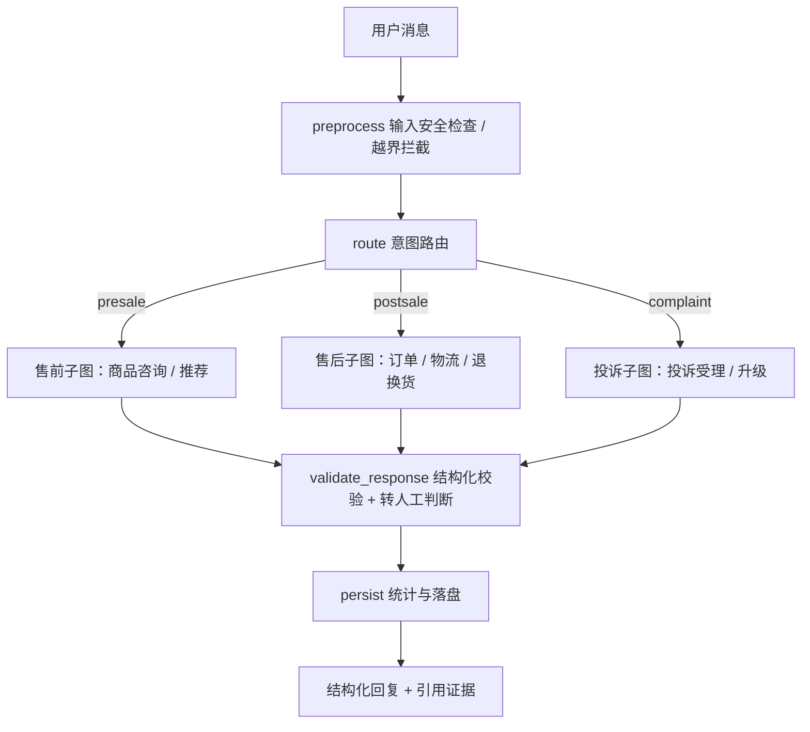
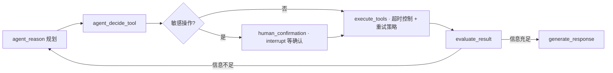

<div align="center">

# 🛍️ SuperBizAgent

### 基于 Adaptive-RAG 的多智能体电商客服 Agent 系统

从「一个 Agent 挂一堆工具」演进为 **Supervisor 父图 + 售前 / 售后 / 投诉三个专业子图**，
用 Adaptive-RAG 提升政策类问答的召回质量，用人工确认 + 幂等 + 审计守住退款这类高风险操作，
用 Checkpoint 让中断的流程可以按 `thread_id` 继续跑。


</div>

---

## 这是什么

一个**电商客服场景**的 Agent 工程实践项目，覆盖商品咨询、订单查询、物流跟踪、退款申请和投诉处理。

项目不是一上来就设计成多智能体，而是**从单 Agent 演进过来的**，每一步都在解决真实问题：

| 遇到的问题 | 解决方式 |
|---|---|
| 所有工具都暴露给模型，工具一多选择就出错 | 按业务域拆子图，每个子 Agent 只挂本领域工具（`allowed_tools` 白名单） |
| 售前 / 售后 / 投诉流程差异大，Prompt 越写越长 | Supervisor 只做路由与流程控制，领域细节下沉到三个专业子图 |
| 出错后分不清是路由错、工具参数错还是回复生成错 | 显式状态机（LangGraph）+ 结构化输出 + 可观测 trace，逐层定位 |
| 向量检索召回的文档一多就混入相似但不相关的内容 | Adaptive-RAG：QueryRewrite → 策略路由 → 向量 + BM25 双路召回 → RRF → Rerank |
| 退款这类写操作不能交给模型自己决定 | 退款计划 → `interrupt` 暂停等人确认 → 幂等键 + 审计记录后才真正执行 |
| 工具超时 / 等确认期间服务重启，流程就断了 | Checkpoint 保存执行节点、工具结果与等待确认状态，同 `thread_id` 可续跑 |

---

## 核心能力

| 能力 | 对应实现 |
|---|---|
| **Supervisor 多智能体编排**（安全边界检查 → 意图路由 → 子图执行 → 结构化校验 → 落盘） | `app/multi_agent/supervisor.py` |
| **三个可复用子图**：`agent_reason → decide_tool → [人工确认] → execute_tools → evaluate_result → generate_response` | `app/multi_agent/subgraphs.py` |
| **工具按域隔离**：售前 / 售后 / 投诉各持独立 `ToolManager` + 白名单 | `app/multi_agent/agents.py`、`app/agent/tools/manager.py` |
| **Adaptive-RAG**：多轮指代消解 + 策略路由（vector / keyword / hybrid）+ RRF 融合 + Cohere Rerank | `app/agent/rag/{rewriter,router,hybrid_retriever,bm25_backend}.py` |
| **证据链与拒答**：返回 `source / section / version / score / retrieval_method` 与 `reliable` 标志，低置信度不给结论 | `app/agent/tools/knowledge.py` |
| **退款安全**：退款计划 + `interrupt` 人工确认 + 幂等键 + 审计表（同事务）+ 非幂等操作禁止重试 | `app/agent/tools/refund.py` |
| **断点续跑**：MemorySaver / SQLite Checkpoint，按 `thread_id` 恢复中断流程 | `app/multi_agent/checkpoint.py` |
| **护栏与兜底**：幻觉检测 + 自纠错、查询越界拦截、规划/工具失败双向 Fallback | `app/agent/guardrails.py` |
| **记忆与技能**：短期会话记忆、长期按用户持久化；SKILL.md 渐进式披露按需加载 | `app/agent/memory/`、`app/agent/skills/` |
| **离线评估体系**：意图路由集、RAG 对比集、黄金场景集、退款安全专项，代码规则 + LLM judge 双层评分 | `app/evaluation/`、`app/scripts/` |
| **服务化接口**：`POST /chat`、`/chat/{thread_id}/resume|reset`、`GET /chat/{thread_id}/state`、`/health`，附本地网页调试台 | `app/api/`、`app/web/` |

---

## 架构

**父图（Supervisor）**



**子图内部（三个子图同构，工具与领域 Prompt 不同）**



**四种运行模式可共存切换**（`main.py` 按配置选择）：LangGraph Supervisor（默认）／旧 Multi-Agent 编排器／单 Agent LangGraph 状态机／原始 ReAct `EcomAgent`。

---

## 离线评测

所有指标都来自仓库内的固定测试集与评测脚本，可用 `python -m app.scripts.*` 复现；
测试集规模有限，用于版本对比与回归验证，不等同于线上生产指标。

| 评测项 | 数据集 | 结果 | 复现命令 |
|---|---|---|---|
| 意图路由准确率 | 100 条（售前 40 / 售后 41 / 投诉 19） | **93.0%**（售前 90.0% / 售后 97.6% / 投诉 89.5%） | `python -m app.scripts.run_intent_eval` |
| RAG 检索质量对比 | 44 条（编号 22 / 语义 12 / 混合 10） | 标准 **MRR 0.844** → Adaptive-RAG **MRR 0.924**（+10%） | `python -m app.scripts.run_rag_eval` |
| 端到端黄金场景 | 10 个完整用户场景 | 路由 10/10、工具调用准确率 100%、关键信息完整度 100%、转人工判断 100% | `python -m app.scripts.run_eval --mode supervisor --no-judge` |
| 退款安全专项 | 10 个高风险用例（确认 / 取消 / 模糊输入 / 重复确认 / 重启续跑 / 超时） | 全部通过 | `pytest tests/test_refund_safety.py` |
| 单元测试 | 21 个测试文件 | **133 passed, 20 skipped** | `pytest` |

知识库：20 篇电商政策 / FAQ / 流程文档，切分为 **117 个 chunk**，同时构建向量索引与 BM25 索引。

---

## 快速开始

```bash
cd ecom-service-agent-main

# 1. 依赖（Python 3.11+）
python -m venv .venv
.venv\Scripts\activate        # Windows；macOS/Linux: source .venv/bin/activate
pip install -r requirements.txt

# 2. 配置（LLM 走任意 OpenAI 兼容接口；embedding 可单独配置）
cp .env.example .env          # 填 OPENAI_API_KEY / OPENAI_BASE_URL / MODEL_NAME
                              # 可选：EMBEDDING_API_BASE / EMBEDDING_API_KEY / EMBEDDING_MODEL

# 3. 构建知识库索引（首次运行一次即可）
python -m app.scripts.build_kb_index

# 4. 启动对话
python main.py
```

想要网页调试台或接服务：

```bash
python -m app.api.server      # http://127.0.0.1:8000/
```

对话里可以直接试这些：

- `我的订单还没发货，怎么回事？` —— 触发订单 + 物流查询
- `有没有宽松透气的裤子推荐？` —— 触发商品推荐技能
- `这件衣服质量有问题，我要退货` —— 触发退款流程（会先暂停等你确认）

---

## 仓库结构

```
.
├── ecom-service-agent-main/          # 项目代码
│   ├── main.py                       # CLI 入口（四种运行模式切换）
│   ├── app/
│   │   ├── multi_agent/              # Supervisor 父图 + 子图 + Router + Checkpoint
│   │   ├── agent/
│   │   │   ├── rag/                  # Adaptive-RAG（rewriter / router / hybrid / bm25）
│   │   │   ├── tools/                # 订单、物流、商品、退款、知识检索、记忆、技能
│   │   │   ├── guardrails.py         # 幻觉检测 + 自纠错 + 越界拦截 + 双向 Fallback
│   │   │   ├── memory/               # 短期 / 长期记忆
│   │   │   └── skills/               # SKILL.md 渐进式披露
│   │   ├── api/ + web/               # 标准库 HTTP 服务 + 本地调试台
│   │   ├── evaluation/ + scripts/    # 测试集与离线评测脚本
│   │   └── prompts/                  # 客服 / 子 Agent / 评估 Prompt
│   ├── docs/                         # 分阶段实现笔记（Prompt 工程 → 评估体系）
│   └── tests/                        # 133 项单元测试（Mock，无需 API Key）
└── *.md                              # 本地笔记
```

---

## 技术栈

Python 3.11+ · LangGraph · OpenAI Function Calling 兼容协议 · Pydantic ·
向量检索 + BM25 + RRF + Cohere Rerank · MCP（Streamable HTTP）· SQLite Checkpoint ·
标准库 `http.server` + 原生前端（零额外依赖）

---

## 已知边界

- API 层是演示级标准库实现：**没有鉴权、没有多租户、限流只在进程内**，生产需要替换为 JWT/OIDC + 网关限流。
- Checkpoint 默认走内存后端，仅适合开发；跨进程请切 SQLite / Postgres。
- 知识库 chunk 预留了 `version / effective_time / updated_at` 字段，尚未接入文档过期自动下架。
- 评估用的 LLM judge 与推理模型搭配时会消耗较多推理 token，长跑评测建议换非推理模型。

---

## 说明

本项目在电商客服 Agent 教学项目的基础上二次开发，用于个人学习与求职作品集；
仓库内同时保留了个人笔记材料，供参考讨论。使用代码前请阅读项目内的 `授权条款.md`。
