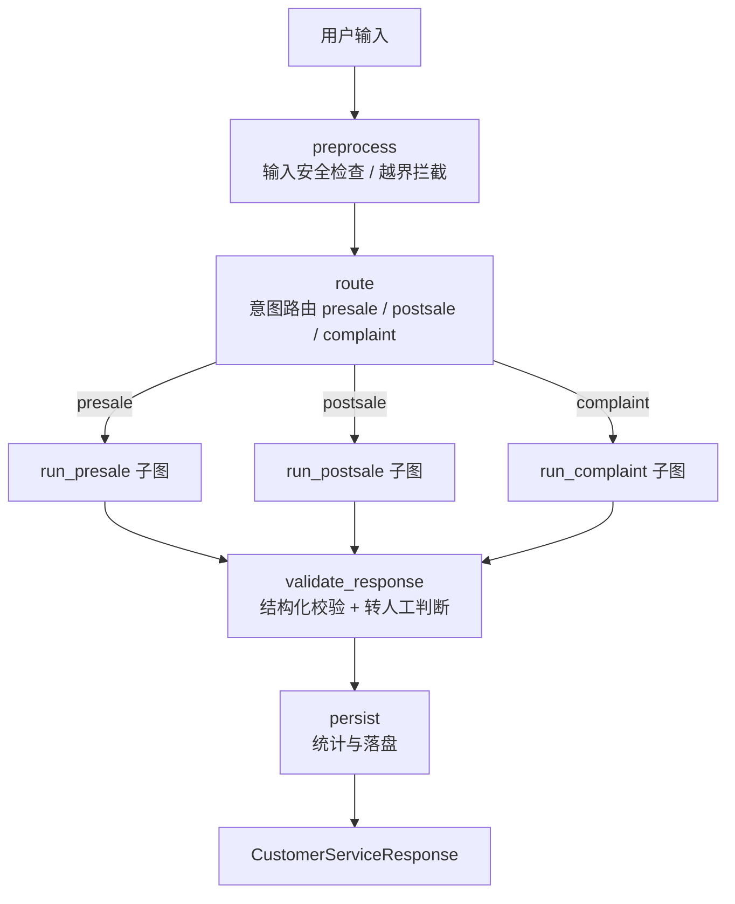

# 01 · 架构总览

> 本目录描述项目的**当前实现**。历史分阶段说明（按"第 N 期"逐步叠加的旧版本）已不再维护。

## 1. 项目定位

面向电商客服场景的 Agent 工程实践，覆盖商品咨询、订单查询、物流跟踪、退款申请与投诉处理。

重点不是"让模型回答得像客服"，而是让流程**可控、可恢复、可评估**：

| 目标 | 落点 |
|---|---|
| 工具选择不出错 | 按业务域拆子图，每个子 Agent 只挂本领域工具（白名单隔离） |
| Prompt 不随场景膨胀 | Supervisor 只做路由与流程控制，领域细节下沉到子图 |
| 出错能定位 | 显式状态机 + 结构化输出 + trace，路由 / 子图 / 工具逐层可查 |
| 知识类回答有依据 | Adaptive-RAG 证据链 + 可靠性阈值，低置信度直接拒答 |
| 高风险操作不失控 | 退款走「查询资格 → 计划 → 人工确认 → 幂等执行 → 审计」 |
| 中断可续跑 | Checkpoint 保存执行节点与等待确认状态，按 `thread_id` 恢复 |

## 2. 运行路径（唯一主线）

项目只保留一条编排路径：**LangGraph Supervisor 父图 + 三个领域子图**。
`main.py`（CLI）与 `app/api/server.py`（HTTP 服务）都直接构建 `SupervisorAgent()`，
没有模式开关，行为可预期、链路可追踪。

| 入口 | 代码 | 说明 |
|---|---|---|
| CLI 对话 | `main.py` → `SupervisorAgent` | 交互式调试，支持 `skills` / `memory` / `reset` 命令 |
| HTTP 服务 | `app/api/server.py` → `SupervisorAgent` | `/chat`、`/resume`、`/reset`、`/state`、`/health` |
| 离线评测 | `app/evaluation/sandbox.py` → `SupervisorAgent` | 隔离 + 插桩，跑黄金集与专项测试 |

> 早期的单 Agent ReAct、单 Agent 状态机与旧版 Router + SubAgent 编排器已下线，
> 仓库只保留 Supervisor 一条链路；历史实现见 git 历史。

## 3. 父图数据流



节点定义见 `app/multi_agent/supervisor.py`（`builder.add_node(...)`）。

## 4. 状态模型

父图与子图共享 `SupervisorState`（`app/multi_agent/state.py`），但**字段归属明确分离**：

| 归属 | 字段 | 说明 |
|---|---|---|
| 父图 | `user_input / selected_agent / intent / conversation / messages / metadata` | 由父图节点读写 |
| 父图 | `final_response / structured_response / requires_human / blocked / error` | 最终结果与错误标记 |
| 父图 | `confirmation_payload / confirmation_result / confirmation_time` | 人工确认记录 |
| 子图 | `iteration / pending_tool_calls / tool_results / is_complete / waiting_for_confirmation` | 子图临时状态 |

子图入口节点 `agent_enter` 会**显式重置所有子图临时字段**，保证：
presale 的 `tool_results` 不污染 postsale、多轮不复用上一次的 `pending_tool_calls`、
中断恢复时新请求不覆盖旧请求状态、父图并行调用多个子图时字段不冲突。

## 5. 目录结构

| 路径 | 职责 |
|---|---|
| `app/multi_agent/` | Supervisor 父图、三个子图、Router、状态模型、结构化输出、Checkpoint 工厂 |
| `app/agent/rag/` | Adaptive-RAG：切分、Embedding、向量后端（numpy / chroma）、BM25、Query Rewrite、策略路由、RRF + Rerank |
| `tools/` | 工具注册表、ToolManager（本地 + MCP）、风险分级、退款幂等与审计、Mock 数据 |
| `app/agent/memory/` | 短期（会话内）与长期（按用户持久化）记忆 |
| `skills/` + `app/agent/skills/` | 技能内容（4 个 `SKILL.md`，放项目根）+ 加载器（扫描 / catalog / 按需加载） |
| `app/agent/guardrails.py` | 越界检查、幻觉检测、自纠错、规划/工具双向 Fallback |
| `app/agent/compressor.py` | Token 预算与三层渐进式压缩 |
| `app/api/` + `app/web/` | 标准库 HTTP 服务与本地调试台 |
| `app/evaluation/` + `app/scripts/` | 测试集、指标、沙箱、离线评测脚本 |
| `mcp_server/` | MCP 工具服务（Streamable HTTP）：暴露业务工具 + 2 个 MCP 独有工具（售后工单） |
| `docs/` | 当前框架文档（本目录） |
| `tests/` | 14 个测试文件、119 项用例（Mock，无需 API Key） |

## 6. 关键配置

完整配置清单见 [08-运行、配置与部署](08-运行、配置与部署.md)。最常用的几项：

```bash
HUMAN_CONFIRMATION_ENABLED=true    # 退款等敏感操作是否需要人工确认
SUBGRAPH_MAX_STEPS=5               # 子图最大循环步数（防死循环）
TOOL_TIMEOUT=30.0                  # 工具调用超时（秒）
CHECKPOINT_ENABLED=true
CHECKPOINT_BACKEND=memory          # memory / sqlite / postgres / auto
ADAPTIVE_RAG_ENABLED=false         # 打开后走 Adaptive-RAG 混合检索链路
GUARDRAILS_ENABLED=false           # 幻觉检测 + 自纠错
```
