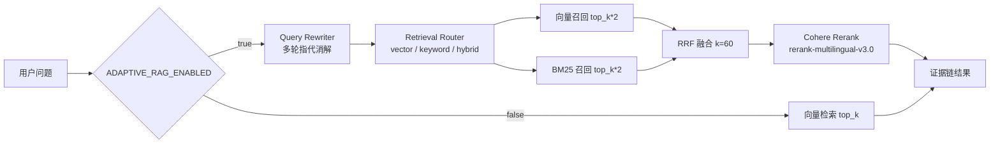

# 03 · Adaptive-RAG 检索链路

对应代码：`app/agent/rag/`、`app/agent/tools/knowledge.py`、`app/scripts/build_kb_index.py`

## 1. 知识库与切分

- 源文档：`app/agent/rag/knowledge/*.md`，当前 **20 篇**电商政策 / FAQ / 流程文档，纯 Markdown。
- 切分规则（`app/agent/rag/chunker.py`）：以 `## ` 二级标题为边界，文档开头到第一个二级标题之间是"概览"块；
  单块超过 `MAX_CHUNK_CHARS = 250` 字时按段落继续拆分。
- 每个 chunk 生成稳定 id：`{doc}#{idx:02d}-{sub_idx:02d}`，便于增量更新与引用定位。
- chunk 预留证据字段：`source / title / version / effective_time / updated_at / tags`
  （当前文档未填版本信息，字段为空值）。

## 2. 索引构建

```bash
python -m app.scripts.build_kb_index          # 默认按 RAG_BACKEND 建索引
python -m app.scripts.build_kb_index --backend chroma
```

一次构建产出两份索引：

| 索引 | 路径 | 用途 |
|---|---|---|
| 向量索引 | `KB_INDEX_PATH`（默认 `app/sessions/kb_index.json`，numpy 后端） | 语义召回 |
| BM25 索引 | `BM25_INDEX_PATH`（默认 `app/sessions/bm25_index.json`） | 关键词 / 编号精确召回 |

Embedding 可独立于 LLM 配置：`EMBEDDING_API_BASE` / `EMBEDDING_API_KEY` / `EMBEDDING_MODEL`
（留空则回退到 LLM 的 `OPENAI_*`）。当前实测：**117 个 chunk、1024 维向量**。

## 3. 两条检索链路

`ADAPTIVE_RAG_ENABLED` 决定走哪条：



- **Query Rewriter**（`rewriter.py`）：结合对话历史把"那个政策是什么"改写成"退换货政策是什么"，解决多轮指代。
- **Retrieval Router**（`router.py`）：用 LLM 判断查询类型——语义类走 `vector`、含编号/专有名词走 `keyword`、
  其余默认 `hybrid`。
- **RRF 融合**（`hybrid_retriever.py::_rrf_fusion`，`k=60`）：只依赖相对排名，避免向量分数与 BM25 分数不同量纲的问题。
- **Cohere Rerank**：配置了 `COHERE_API_KEY` 时对融合后的候选做语义精排；未配置则跳过。

## 4. 证据链与拒答

`search_knowledge`（`app/agent/tools/knowledge.py`）返回：

```
evidence_id / doc / title / section / score / text
/ source / version / effective_time / updated_at / retrieval_method
```

以及 `reliable` 标志：

- 标准模式阈值 `RAG_SCORE_THRESHOLD`（默认 0.45），Adaptive 模式阈值 `RAG_ADAPTIVE_SCORE_THRESHOLD`（默认 0.02，量纲不同）；
- top1 低于阈值或没有召回 → `reliable=false`，**结果清空**并返回安全提示
  （"未检索到可靠的政策依据，请转人工核实或直接查询"），避免模型拿低置信片段编政策；
- 上层 Prompt 明确要求：政策类问题必须先检索，禁止凭常识补写规则。

## 5. 后端切换

| 后端 | 说明 |
|---|---|
| `numpy`（默认） | 手写余弦相似度 + JSON 持久化，零额外依赖，便于观察检索本质 |
| `chroma` | 嵌入式向量数据库（HNSW），需 `pip install chromadb` |
| `bm25` | 纯 Python BM25，供 Adaptive-RAG 关键词召回使用 |

## 6. 评测结果

```bash
python -m app.scripts.run_rag_eval     # 44 条用例，标准 vs Adaptive 对比
```

最近一次实测（embedding：bge-m3 1024 维；Rerank：Cohere）：

| 指标 | 标准模式 | Adaptive-RAG | 变化 |
|---|---|---|---|
| MRR | 0.844 | **0.924** | +10% |
| Recall | 100% | 100% | — |
| Precision | 21.8% | 20.5% | -6% |

分类别 MRR：编号/代码类 `0.895 → 0.977`、语义类 `0.764 → 0.861`、混合类 `0.825 → 0.883`。

## 7. 已知边界

- RRF 融合会引入更多候选，**Precision 会略降**，靠 Rerank 把不相关的压下去；客服场景更关心"对的内容排前面"（MRR）。
- 检索策略路由以 LLM 判断为主，当前测试集中多数问题落 `hybrid`，`keyword` 只在出现明确编号时才触发。
- chunk 的 `version / effective_time / updated_at` 仅预留，尚无文档过期自动下架机制。
