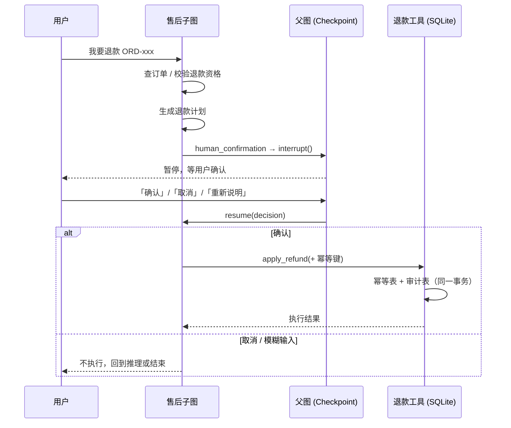

# 04 · 退款安全与人工确认

对应代码：`tools/refund.py`、`tools/risks.py`、
`app/multi_agent/subgraphs.py`（`human_confirmation` 节点）

## 1. 风险分级

工具按副作用分级（`risks.py`）：

| 级别 | 含义 | 当前工具 |
|---|---|---|
| `read_only` | 只读查询，无副作用，失败可安全重试 | `query_order`、`query_logistics`、`query_product`、`list_user_orders`、`search_knowledge`、`recall_user_memory`、`load_skill` |
| `requires_confirmation` | 高风险写操作，非幂等，禁止自动重试，必须先人工确认 | `apply_refund` |

> `compensation`（赔偿）与 `complaint_escalation`（投诉升级）**尚未实现**，
> 仅在分级表中预留；实现接入时必须同样走确认 + 幂等流程。

## 2. 端到端流程



## 3. 关键机制

| 机制 | 实现 |
|---|---|
| 确认词归一化 | `normalize_confirmation()`：`确认 / 取消 / 重新说明` 三类；**无法识别时默认按"重新说明"处理，绝不默认确认** |
| 幂等键 | `_make_idempotency_key(thread_id, tool_name, arguments)`：同一订单同一请求重复提交只会执行一次 |
| 审计留痕 | `refund_idempotency`（幂等结果）与审计记录写在**同一事务**，避免"执行了但没记账" |
| 禁止自动重试 | 执行层按风险分级跳过重试；只有 `retryable` 错误才退避重试 |
| 超时 | `TOOL_TIMEOUT` 超时后按失败处理，**不会**因为超时重发退款 |
| 进程重启后恢复 | 等待确认的状态写在 Checkpoint 里，重启后用同一个 `thread_id` 继续 `resume` |
| 中断判据 | 依赖 Checkpoint snapshot 的 `next` 是否为空，而不是内存字典，所以跨进程也成立 |

## 4. CLI / API 交互方式

CLI（`python main.py`）里，退款会先返回一条确认提示，然后直接输入：

```
确认          # 执行退款
取消          # 放弃
重新说明      # 回到推理节点重新规划
```

API 侧用 `POST /chat/{thread_id}/resume`，body：`{"decision": "确认"}`。

## 5. 测试

```bash
pytest tests/test_refund_safety.py -q      # 10 项专项安全用例
```

覆盖场景：首次确认执行、重复确认不重复退款、取消不执行、模糊输入不执行、
进程重启后重复确认不重复执行、幂等键冲突返回已有结果、订单不存在、
退款中状态拒绝、参数错误不执行、超时未知结果不重试。

## 6. 已知边界

- 退款存储是本地 SQLite（`REFUND_STORE_PATH`，默认 `app/sessions/refunds.db`），
  多实例部署需要换成共享存储并加分布式锁。
- 只覆盖 refund 一条高风险写链路；真正的赔偿 / 升级流程还未实现。
