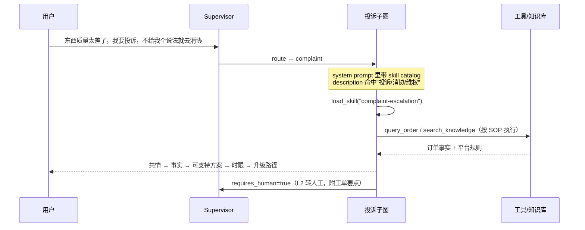

# 09 · Skill 可复用能力模块

对应代码：`app/agent/skills/loader.py`、`tools/skill_tool.py`；
技能内容：`skills/*/SKILL.md`

## 1. 一句话

**Skill 是把"一类业务问题的处理流程"写成 Markdown SOP，放在目录里按需加载**——
模型先看目录（只有名字 + 描述），判断匹配后再把完整流程读进上下文，
改流程不用改代码、不用发版。

## 2. 与工具、与"把流程写进 system prompt"的区别

| | 工具（Tool） | 长 system prompt | **Skill** |
|---|---|---|---|
| 载体 | 代码 + JSON Schema | 一大段常驻 Prompt | Markdown 文件 |
| 约束强度 | 硬约束（运行时校验） | 软约束 | 软约束 |
| 常驻上下文成本 | Schema 一直占 token | 全部流程一直占 token | 只有 `name + description`（约 100 token/个） |
| 谁维护 | 开发改代码、测试、发版 | 开发改代码 | 业务/运营可改 Markdown |
| 适合描述 | 原子动作（查订单、退款） | 全局人设与边界 | 多步业务流程（SOP） |

结论：**工具管"能做什么"，技能管"按什么步骤做"**，两者互补而不是替代。

## 3. 规范与目录结构

遵循 Agent Skills 开放标准（`agentskills.io/specification`）：**一个技能 = 一个目录 + 一个 `SKILL.md`**。

```
ecom-service-agent-main/
├── skills/                          # 技能内容：放项目根，像 .claude/skills 一样"一眼可见"
│   ├── process-return/SKILL.md
│   ├── track-order/SKILL.md
│   ├── product-recommend/SKILL.md
│   └── complaint-escalation/SKILL.md
└── app/agent/skills/loader.py       # 加载器代码：扫描 / 解析 / 生成 catalog / 按需加载
```

`SKILL.md` = YAML frontmatter（`name` + `description`）+ Markdown 指令体。
`description` 要写清**什么时候用**（含适用关键词），因为模型就是靠它判断要不要加载。

**为什么内容放根目录、代码放 `app/`**：技能是"业务数据"不是"代码"——放根目录便于运营/业务同学直接改、
在仓库首页就能看见有哪些技能（和 Claude Code 的 `.claude/skills/`、Codex 的 `skills/` 约定一致）；
而扫描、解析、注入 catalog 的逻辑属于工程实现，留在 `app/agent/skills/` 里。
路径由 `SKILLS_DIR` 控制，改成别的目录也能用。

## 4. 两级加载（token 经济学）

| 阶段 | 加载内容 | 触发 |
|---|---|---|
| 启动 / 每轮请求 | `name + description` 组成的 catalog，注入子图 system prompt | `SkillManager.build_catalog_prompt()` |
| 模型判断匹配后 | 完整 `SKILL.md` body 作为工具结果进入上下文 | `load_skill(skill_name=...)` |

加载是一次性的：`SkillMeta.load_body()` 内部缓存，同一个技能重复加载不会重复读文件。
`SKILLS_ENABLED=false` 时 catalog 为空、`load_skill` 直接返回"技能系统未启用"。

## 5. 内置技能

| 技能 | 适用场景 | 主要步骤 | 用到的工具 |
|---|---|---|---|
| `process-return` | 退货 / 退款 / 换货 | 确认订单 → 判断状态 → 校验资格 → 确认意愿后申请退款 → 告知进度 | `query_order`、`list_user_orders`、`search_knowledge`、`apply_refund` |
| `track-order` | 查订单状态、物流到哪了 | 查订单 → 查物流 → 异常判定 → 综合建议 | `query_order`、`query_logistics` |
| `product-recommend` | 想买、求推荐 | 了解需求 → 查历史偏好 → 搜索商品 → 给出 2-3 个选项与理由 | `query_product`、`list_user_orders`、`recall_user_memory` |
| `complaint-escalation` | 强烈不满、要求赔偿、威胁投诉到监管 | 先安抚 → 核实事实与举证 → 检索规则 → 分级处理（L1 自助 / L2 转人工） → 按"共情-事实-方案-时限-升级路径"输出 | `query_order`、`query_logistics`、`list_user_orders`、`search_knowledge` |

## 6. 一次真实调用链（投诉场景）



**与工具隔离的配合**：投诉子图本身没有 `apply_refund`，技能里也明确写了"投诉场景没有退款工具，
任何退款都要转人工走正式流程"——技能与白名单两把锁同时生效。

## 7. 配置与手工验证

```bash
SKILLS_ENABLED=true                 # 技能总开关
SKILLS_DIR=skills                  # 相对路径按项目根解析，改目录不影响启动方式
```

CLI 里输入 `skills` 可以列出当前加载的技能目录；
`load_skill` 是注册表中的标准工具，模型按需调用，也可以在测试里直接调用。

## 8. 测试

```bash
pytest tests/test_skills.py -q
```

覆盖：发现与数量、catalog 生成、`load_skill` 成功 / 未知技能、关闭开关、
延迟加载（`_body_loaded` 语义）、以及投诉升级技能的加载与内容校验。

## 9. 设计要点

- **为什么不用"把流程写进 system prompt"**：所有 SOP 常驻会让 prompt 越来越长、注意力被稀释、token 成本线性上升；
  技能做成"目录 + 按需加载"后，常驻成本只有约 100 token/个。
- **谁的活**：新增/调整业务流程只改 Markdown，业务同学也能维护，可单独灰度、快速回滚，不需要发版。
- **和工具的分工**：技能是软约束的编排说明书，真正的副作用仍由工具承接（退款要走确认 + 幂等），
  所以技能描述错了不会造成资金风险，只会让流程变差——这也是为什么能把技能交给业务维护。
- **怎么验证技能有效**：用评估集回归（意图路由 + 黄金场景 + 退款安全），
  改动技能后重跑 `python -m app.scripts.run_eval --mode supervisor --no-judge` 对比过程指标。

## 10. 已知边界

- 技能是**软约束**：模型可能忽略或不完全遵循，关键动作仍要落到工具与白名单上兜底。
- 当前没有技能级版本管理 / 灰度：`skills/` 目录内容即生效，改动需要靠评估回归来保障。
