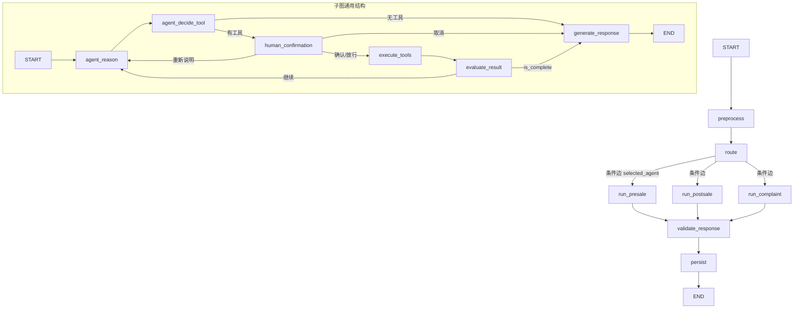

# LangGraph Supervisor 重构说明

本文档记录本次「三个 SubAgent → 三个 CompiledStateGraph + 父级 Supervisor Graph」重构的完整改动。

## 0. 关键前提：实际 LangGraph 版本

`requirements.txt` 声明 `langgraph>=1.0.0`，但**当前环境实际安装的是 `langgraph 0.2.70`**
（`langgraph-checkpoint 2.1.2`、`langchain-core 0.3.86`）。本次所有代码均以 0.2.x API 为准：

- 可用：`MemorySaver` / `InMemorySaver`（`langgraph.checkpoint.memory`）
- 可用：`interrupt` / `Command(resume=...)`（`langgraph.types`）
- **不可用**：`SqliteSaver`（需额外安装 `langgraph-checkpoint-sqlite`，本项目未装）

已通过最小实验验证的语义：

1. 子图作为父图节点运行时不携带自己的 checkpointer，子图内部的 `interrupt()` 会冒泡到父图。
2. 中断恢复（`Command(resume=...)`）只重跑当前被中断节点，不会重跑上游节点，因此 LLM 不会被重复调用。
3. 中断节点的中断前写操作不会被提交（节点必须保持幂等，敏感操作前先 `interrupt()`）。

## 1. 修改过的文件列表

### 新增文件

| 文件 | 作用 |
|------|------|
| `app/multi_agent/state.py` | 统一 `SupervisorState`（TypedDict）+ 确认输入归一化 |
| `app/multi_agent/structured.py` | 统一结构化输出（response_format + 确定性 fallback，不再二次 LLM 提取） |
| `app/multi_agent/checkpoint.py` | Checkpointer 工厂（MemorySaver，预留 SQLite）+ thread_id 派生 |
| `app/multi_agent/subgraphs.py` | 三个子图工厂 + 通用 `_build_subagent_graph` |
| `app/multi_agent/supervisor.py` | `SupervisorAgent`（父图调度 + checkpoint + interrupt） |
| `app/agent/tools/errors.py` | 工具错误分类 + 参数校验（供 graph.py 与子图复用） |
| `tests/test_supervisor_graph.py` | Mock LLM/ToolManager 的 16 项测试 |

### 修改文件

| 文件 | 改动 |
|------|------|
| `app/multi_agent/__init__.py` | 导出 `SupervisorAgent` / `SupervisorState` / 三个子图工厂 |
| `app/agent/graph.py` | 修复路由/plan/评估/元数据/工具错误分类等既有问题 |
| `app/config/settings.py` | 新增 `supervisor_enabled` / `checkpoint_enabled` / `checkpoint_path` / `human_confirmation_enabled` / `subgraph_max_steps` |
| `.env.example` | 同步新增上述配置 |
| `main.py` | 重构模式选择优先级（Supervisor 为默认推荐） |
| `README.md` | 新增「LangGraph Supervisor」章节 + 架构树更新 |

### 未改动（保留旧实现）

- `app/multi_agent/agents.py`（旧 `SubAgent`）与 `app/multi_agent/orchestrator.py`（旧 `MultiAgentOrchestrator`）完整保留。
- `app/agent/chat.py`（`EcomAgent`）、`app/agent/memory/`、`app/agent/skills/`、RAG、MCP、`CustomerServiceResponse` 全部保留。

## 2. 新增的核心类、函数和 Graph 节点

### 核心类

- `SupervisorAgent`：父图编排器，对外接口与 `EcomAgent` 一致（`chat/reset/save/close/history_size`），额外提供 `resume(thread_id, decision)` 与 `get_state(thread_id)`。

### 核心函数

- `build_presale_graph(...)` / `build_postsale_graph(...)` / `build_complaint_graph(...)`：三个子图工厂。
- `_build_subagent_graph(...)`：通用子图构建函数（三个子图复用，避免复制三份代码）。
- `build_checkpointer(enabled, path)`：checkpointer 工厂。
- `thread_id_from_session(session_path, user_id)`：派生稳定 thread_id。
- `classify_tool_error(result_str)` / `validate_tool_arguments(name, args, defs)`：工具错误分类与参数校验。
- `build_structured_response` / `coerce_structured` / `safe_default_response` / `serialize_response` / `deserialize_response`：统一结构化输出工具。
- `normalize_confirmation(user_input)`：把「确认/取消/重新说明」等输入归一化。

### 子图节点（每个子图都具备）

- `agent_reason`：分析任务，调用 LLM 规划器产出工具计划。
- `agent_decide_tool`：校验工具调用（未知工具/参数非法安全拒绝）。
- `human_confirmation`：敏感工具（`apply_refund`）执行前 `interrupt()` 暂停。
- `execute_tools`：执行工具 + 错误分类 + 可重试退避。
- `evaluate_result`：判断信息是否足够，写 `is_complete`。
- `generate_response`：生成最终回复 + 结构化输出（含取消场景兜底）。

### 父图节点

- `preprocess` / `route` / `run_presale` / `run_postsale` / `run_complaint` / `validate_response` / `persist`。

## 3. 父图与三个子图的调用关系



- 父图 `run_presale/run_postsale/run_complaint` 三个节点直接就是三个已编译子图（`builder.add_node("run_x", subgraph)`）。
- 子图状态与父图共用 `SupervisorState`，子图入口不会污染其他子 Agent 的临时字段。
- 父图只读取子图产出的 `final_response` / `structured_response` / `requires_human` / `tool_results`。

## 4. Checkpoint 的实现方式

- **只有父图 `compile(checkpointer=...)` 携带 checkpointer**；三个子图作为父图节点运行，**不单独携带**，继承父图 `thread_id` 与 checkpoint，避免重复嵌套造成状态冲突。
- 开发环境：`MemorySaver`（进程内，满足中断恢复与多轮测试）。
- 生产预留：`build_checkpointer` 检测到 `langgraph-checkpoint-sqlite` 后自动切 SQLite，否则回退 `MemorySaver`。
- `thread_id` 由 `thread_id_from_session(session_path, user_id)` 稳定派生，跨进程重启不变。
- 兼容策略：现有 `session.json` 仍是「对话历史」的持久化载体；checkpoint 主要负责「单轮内中断/恢复」。二者通过 thread_id 对齐，未破坏既有 JSON 存储。

## 5. 人工介入流程

```
execute_tools 前
  → human_confirmation 检测 pending_tool_calls 中的敏感工具（apply_refund）
  → interrupt(payload) 暂停父图
  → 返回给调用方「等待确认」响应
  → 用户输入「确认」→ Command(resume="确认") → 执行 apply_refund
  → 用户输入「取消」→ Command(resume="取消") → 跳过执行，返回取消话术
  → 用户输入「重新说明」→ 回到 agent_reason 重新规划
```

- `apply_refund` 默认必须等待用户明确确认，**模型无法自行跳过**。
- 确认输入支持「确认/确定/同意/好的/confirm/ok/yes/是」等（见 `normalize_confirmation`）。
- `waiting_for_confirmation` / `confirmation_payload` / `confirmation_result` 字段记录确认状态。

## 6. 测试执行结果

运行 `python tests/test_supervisor_graph.py`（纯 Mock，无需真实 API Key）：

```
[1/16] 三个子图独立构建           [OK]
[2/16] 三个子图独立调用           [OK]
[3/16] presale 只能访问售前工具   [OK]
[4/16] postsale 可以访问售后工具  [OK]
[5/16] complaint 不能访问退款工具 [OK]
[6/16] Router 正确路由三个场景    [OK]
[7/16] 父图正确调用对应子图       [OK]
[8/16] 子图工具调用轨迹完整       [OK]
[9/16] 达到最大循环次数后安全结束  [OK]
[10/16] 工具失败后安全回复        [OK]
[11/16] Checkpoint 恢复多轮会话   [OK]
[12/16] interrupt 暂停退款流程    [OK]
[13/16] 用户确认后继续执行退款    [OK]
[14/16] 用户取消后不执行退款      [OK]
[15/16] 最终输出符合 CustomerServiceResponse [OK]
[16/16] 原有测试模块仍可导入      [OK]

ALL TESTS PASSED
```

冒烟验证：

- `import main` 成功。
- `SupervisorAgent()` 可实例化，成功构建 3 个子图。

> 说明：原有 `tests/test_agent.py`、`test_multi_agent.py` 等需要真实 API Key 的测试未在无 Key 环境运行，但已确认其依赖模块可正常导入、未被破坏。

## 7. 仍然存在的限制

1. **SQLite Checkpointer 未启用**：当前环境未安装 `langgraph-checkpoint-sqlite`，`build_checkpointer` 会回退到 `MemorySaver`（进程内，重启后 checkpoint 丢失）。生产持久化需额外安装依赖。
2. **Checkpoint 与 JSON 会话双轨**：历史仍以 `session.json` 为准，checkpoint 主要用于单轮中断恢复，未把「多轮历史」完全迁移到 checkpoint。
3. **`preprocess` 的越界短路未硬拦截**：`Guardrails.check_boundary` 默认关闭；即使开启，越界时也只是设置 `requires_human`，流程仍会继续进入子图（不会中断），属「软提示」而非「硬阻断」。
4. **人工确认仅覆盖工具级写操作**：`apply_refund` 已纳入中断确认；「赔偿 / 投诉升级」等无独立工具的诉求，通过 `complaint` 子图 `requires_human=True` 的启发式转人工兜底，而非 `interrupt()` 暂停。
5. **子图规划器为 JSON 规划**（非原生 function calling），沿用既有 `PLANNER_PROMPT` 思路；与旧 `SubAgent.handle()` 的原生 tool_calls 实现不同，但语义等价。

## 8. 下一步建议

1. 生产环境安装 `langgraph-checkpoint-sqlite`（或 `langgraph-checkpoint-postgres`），启用持久化 checkpoint。
2. 把 `human_confirmation` 的敏感工具集合扩展为可配置（如 `SENSITIVE_TOOLS` 从 `.env` 读取），覆盖未来新增的赔偿/改价等写操作。
3. 为父图/子图增加可观测性（在 `metadata` 基础上记录每个节点的耗时、工具成功率），与第 9 期评估体系打通。
4. 将子图规划器从 JSON 规划平滑迁移到原生 function calling（`client.chat.completions.create(tools=...)`），减少一次规划 LLM 调用。
5. 在 `preprocess` 中接入硬性的输入安全拦截（Prompt Injection / 越界直接返回，不进入子图）。